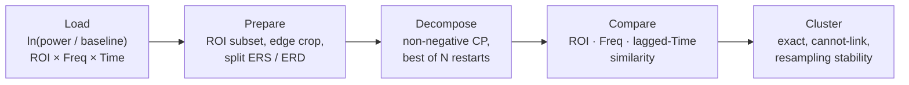

# opm-cp

**Data-driven discovery of event-related brain activity in source-space MEG, using non-negative tensor decomposition and cross-subject component clustering.**


## Why

Analysing event-related oscillatory power usually means fixing a frequency band and a time window in advance, averaging within them, and testing across parcels. That only works if you already know what you are looking for. A real response is a *joint* pattern — specific regions, at specific frequencies, over a specific interval — and fixing two of those three throws away the structure.

`opm-cp` factorises the full **region × frequency × time** tensor of baseline-normalised power. Each dominant pattern comes out as one component with its own spatial map, spectral profile and time course; nothing is specified in advance.

It then solves the problem that follows. Subjects are decomposed independently, so their components arrive in arbitrary order. `opm-cp` works out which component in one subject corresponds to which in another — tolerating the fact that the same response does not occur at the same latency in two people — and reports how stable each cross-subject grouping is.

Built for OPM-MEG parcellated with AAL2, but nothing is OPM-specific: any signed region × frequency × time tensor works.

## How it works



| Stage | Module | Key choice |
|---|---|---|
| Load | `io.py` | Reads MATLAB v7.3 HDF5; axes are transposed back and checked against the stored axis vectors |
| Prepare | `tensors.py` | Power increases (ERS) and decreases (ERD) are split and decomposed separately; `ers - erd == data` exactly |
| Decompose | `decomposition.py` | Best-of-N restarts; rank chosen by **stability** across restarts (Williams et al., 2018), not R² alone |
| Compare | `similarity.py` | Score is the **product** of per-mode similarities, so a match must agree in space, frequency *and* time. The time term is the max normalised cross-correlation within ±`lag_ms` |
| Cluster | `clustering.py` | Integer program with threshold, same-subject cannot-link and transitivity constraints; stability via consensus resampling (Monti et al., 2003) |

The full rationale for each choice is in [`docs/pipeline.md`](docs/pipeline.md). Read it before interpreting results.

## Installation

```bash
git clone https://github.com/hug0-w/opm-cp-pipeline.git
cd opm-cp-pipeline
pip install -e ".[all]"
```

Requires Python ≥ 3.10. The core install needs only numpy, scipy, h5py, torch, tensorly and matplotlib. Optional extras, all included in `all`:

| Extra | Adds | Without it |
|---|---|---|
| `brain` | nibabel, nilearn — glass-brain ROI panels | ROI loadings plot as bar panels |
| `consensus` | pulp, highspy — exact clustering | only greedy `align_components` is available |
| `notebook` | jupyterlab, ipykernel | — |

**Apple Silicon:** install the `consensus` extra rather than pulp alone. pulp's bundled CBC solver is x86-only; the extra pulls in `highspy`, which runs natively.

**Atlas:** AAL2 is not bundled (it has its own licence and citation requirement). It is only needed for glass-brain figures — see [`atlas/README.md`](atlas/README.md).

## Quick start

The worked notebook, [`examples/ers_erd_cross_subject_clustering.ipynb`](examples/ers_erd_cross_subject_clustering.ipynb), runs the whole pipeline on simulated data with known ground truth, so it works from a fresh clone. Its last section checks what was recovered against what went in. To use your own recordings, change the one marked cell.

The core of it:

```python
import opm_cp as cp
from opm_cp import simulate

# Load and prepare (on real data: cp.load_tensor instead of simulate_dataset)
loaded = simulate.simulate_dataset(subjects=(1, 2, 3))
ds = cp.build_dataset(loaded, keep_patterns=['precentral', 'occipital'], n_crop=5)

# Decompose each subject independently, ERS and ERD separately
cp_models, factors = cp.decompose_dataset(ds, rank=3, n_runs=25)

# Match components across subjects and cluster them, once per type
for kind in ('ERS', 'ERD'):
    components = cp.build_component_set(factors[kind], subjects=ds.subjects, rank=3)
    sim = cp.compute_similarity(components, dt_ms=ds.dt_ms, lag_ms=150)
    M, clusters, stability = cp.consensus_clustering(sim, threshold=0.5)
```

### Reading the output

- **`clusters`** — labels 1..K; **0 means unassigned**. A component left unassigned is a result (that subject does not express a shared pattern), not a failure.
- **`stability`** — `m(k)`, mean within-cluster consensus. Near 1 means the grouping is driven by the data; lower values mean it rests on near-ties. This is the number to report.
- **`M`** — the consensus matrix: how often each pair clustered together across resamples.
- **`cluster_quality`** prints per-mode diagnostics and flags forced matches (weak ROI score with strong frequency/time scores) and subjects whose best-matching component sits outside the cluster.

### Parameters that matter

| Parameter | What it controls | Guidance |
|---|---|---|
| `rank` | components per subject | Choose with `rank_selection` + `plotting.plot_rank_selection`: largest rank that is still stable *and* explains useful variance |
| `n_runs` | restarts per fit | The objective is non-convex; too few and a component may reflect one bad initialisation |
| `lag_ms` | tolerated inter-subject latency shift | Wide enough to absorb real jitter, no wider — at large values unrelated transients start matching. Default 100 ms |
| `threshold` | minimum similarity for two components to be linked | Higher is stricter; more components stay unassigned |
| `keep_patterns` | ROI subset (case-insensitive substrings of AAL2 names) | Exclude regions the sensor array covers poorly, e.g. cerebellum |
| `n_crop` | time points dropped from each end | Removes taper edge artefacts, which otherwise attract their own component |

## Figures

ERS is always red and ERD blue, so any figure is identifiable out of context.

| Function | Shows | Use it to |
|---|---|---|
| `plot_tfr_roi` | raw time-frequency maps | check components against the undecomposed data, before and after |
| `plot_rank_selection` | R² and stability vs rank | choose the model order |
| `plot_connectogram_grid` | all pairwise similarities, per mode | see which mode carries cross-subject structure before clustering |
| `plot_cluster` | every member of a cluster separately | **judge** a cluster |
| `plot_cluster_mean` | lag-aligned consensus profile with min–max band | **present** a cluster |

## Project structure

```
src/opm_cp/
  io.py             read time-frequency files and the atlas
  tensors.py        ROI selection, cropping, ERS/ERD split
  decomposition.py  non-negative CP fits and rank selection
  similarity.py     cross-subject component similarity
  clustering.py     greedy alignment and exact consensus clustering
  plotting.py       figures for every stage
  simulate.py       synthetic data with known ground truth
docs/pipeline.md    the method, stage by stage, and why
examples/           end-to-end worked run
atlas/              instructions for obtaining AAL2
```

## Limitations

- **Scaling.** Transitivity constraints make the exact clustering O(n³) in size: fine for the few tens of components a typical study produces, not for hundreds.
- **Null distributions** must be built at the trial level (`pow_trials`). CP is invariant to permuting indices within a mode, so shifting the averaged tensor's time axis gives a degenerate null with p ≈ 1.
- **One component per subject per cluster** is assumed by the cannot-link constraint.
- **Input** is expected as MATLAB v7.3 HDF5 from an upstream time-frequency analysis. Other sources need a dict with the same keys `load_tensor` returns (`pow_norm`, `pow_banded`, `pow_trials`), which is what `simulate` produces.

## References

- Williams et al. (2018). Unsupervised discovery of demixed, low-dimensional neural dynamics across multiple timescales through tensor component analysis. *Neuron* 98(6), 1099–1115.
- Monti et al. (2003). Consensus clustering: a resampling-based method for class discovery and visualization of gene expression microarray data. *Machine Learning* 52, 91–118.
- Rolls et al. (2015). Implementation of a new parcellation of the orbitofrontal cortex in the automated anatomical labeling atlas. *NeuroImage* 122, 1–5.
- Kossaifi et al. (2019). TensorLy: Tensor learning in Python. *JMLR* 20(26), 1–6.

## Licence

MIT. The AAL2 atlas is not included and carries its own terms.

---

*A note on authorship: the code was written by hand, with AI assistance limited to specific tasks such as code review and debugging. Agentic AI was used to assemble it into this repository.*
